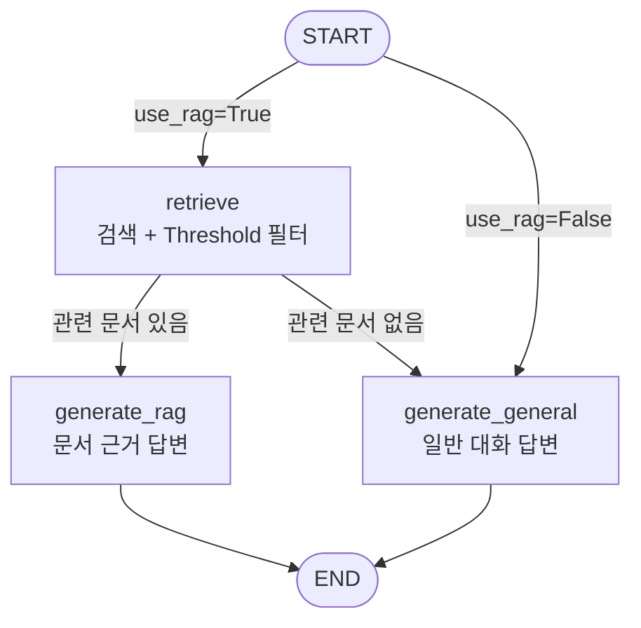
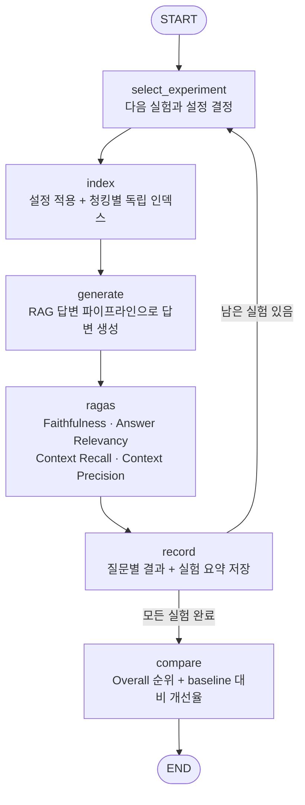

# RAG 챗봇 (SSAFY 교육 규정 · 전국 관광지 정보)

FastAPI + LangGraph + LangChain 기반의 RAG(Retrieval-Augmented Generation) 챗봇입니다.
업로드된 문서를 ChromaDB에 벡터로 저장하고, 질문이 들어오면 관련 문서를 검색해 그 내용을 바탕으로 답변을 생성합니다.

성격이 다른 두 문서로 RAG를 적용하고 평가했습니다.

| 데이터 | 특징 | 청킹 전략 |
| --- | --- | --- |
| **SSAFY 교육생 가이드** (`SSAFY_GUIDE.md`) | 출결·보안·장학 등 규정과 표가 연속된 문서 | 글자 수 기준 분할 (Chunk/Overlap 튜닝) |
| **전국 관광지 정보** (`전국관광지정보_RAG용.md`) | 공공데이터 CSV를 변환한 관광지 735곳 레코드 | 헤더 기준 분할 (관광지 1곳 = 청크 1개) |

## 주요 기능

- **RAG 기반 채팅** (`/chat`): LangGraph 워크플로우로 질문과 관련된 문서를 검색한 뒤 그 내용을 근거로 답변을 생성합니다.
  - `use_rag` 플래그로 RAG 검색을 켜고 끌 수 있습니다.
  - 유사도 Threshold를 통과한 문서가 없으면 일반 생성형 AI로 Fallback하고, 화면에 "일반 생성형 AI 응답 (관련 문서 없음)"을 표시합니다.
  - 검색 방식은 `vector`(의미 검색) 또는 `hybrid`(의미 검색 + BM25 키워드 검색, RRF 결합) 중 선택합니다.
- **문서 업로드 및 벡터 적재** (`/upload`): `.txt`, `.md`, `.pdf` 파일을 업로드하면 자동으로 텍스트를 추출하고 청크로 분할해 ChromaDB에 저장합니다. 마크다운 파일은 헤더(`#`, `##`, `###`) 단위로 분할하고(관광지 1곳 = 청크 1개), 그 외 파일은 `RecursiveCharacterTextSplitter`로 분할합니다. (`MD_SPLIT_MODE=recursive`로 바꾸면 마크다운도 글자 수 기준으로 분할)
- **DB 초기화** (`/reset-db`): ChromaDB에 저장된 모든 문서를 삭제합니다.
- **CORS 실습 API** (`/simpleparam`, `/simplejson`): Simple Request와 Preflight Request의 차이를 실습하기 위한 엔드포인트입니다.
- **RAG 성능 평가 및 튜닝 실험** (`eval_ragas.py`): [Ragas](https://github.com/explodinggradients/ragas) 라이브러리로 Faithfulness, Answer Relevancy, Context Recall, Context Precision 4개 지표를 측정합니다. 데이터셋별로 Chunk Size, Overlap, Top-K, Similarity Threshold, 검색 방식을 바꾼 실험을 한 번에 실행하고 비교표를 생성합니다.
- **웹 채팅 UI** (`clients/`): 채팅, RAG 사용 토글, 문서 업로드, DB 초기화를 브라우저에서 사용할 수 있습니다.

## LangGraph 파이프라인

LangGraph로 **답변 파이프라인**과 **평가·튜닝 파이프라인** 두 개를 설계했습니다. 평가 파이프라인은 실험마다 답변 파이프라인을 호출합니다.

### 1. RAG 답변 파이프라인 (`main.py` `build_rag_graph`)



State에는 답변 외에도 다음 값을 저장하여 RAGAS 평가에 그대로 사용합니다.

| State | 내용 |
| --- | --- |
| `rag_used` | 실제로 검색 문서를 근거로 답했는지 |
| `retrieved_contexts` | LLM에 전달된 청크 목록 (프롬프트 Context와 RAGAS 평가에 공통 사용) |
| `retrieval_scores` | 각 청크의 유사도 점수 |
| `retrieval_config` | 그 답변을 만들 때 적용된 Chunk Size / Overlap / Top-K / Threshold / 검색 방식 |

### 2. 평가·튜닝 파이프라인 (`eval_ragas.py` `build_eval_graph`)

Chunk Size, Overlap, Top-K, Similarity Threshold 실험을 하나의 그래프로 순환 실행합니다.



| 노드 | 역할 |
| --- | --- |
| `select_experiment` | 실험 큐에서 다음 실험을 꺼내 Chunk / Overlap / Top-K / Threshold 설정을 결정 |
| `index` | 현재 실험의 Chunk Size / Overlap으로 독립 인메모리 인덱스를 생성 (같은 청킹은 재사용) |
| `generate` | Top-K / Threshold / 검색 방식 / 인덱스를 RunnableConfig로 주입해 답변 파이프라인을 질문마다 실행하고, State의 검색 결과(`retrieved_contexts`, `retrieval_scores`, `retrieval_config`)를 수집 |
| `ragas` | 답이 문서에 있는 질문을 RAGAS 4개 지표로 채점 |
| `record` | 질문별 CSV와 실험 요약을 저장하고, 근거 없는 답변 회피율을 계산 |
| `compare` | 실행한 실험을 Overall 순으로 정렬하고 baseline 대비 개선율을 계산 |

**튜닝 값은 전역 변수가 아니라 그래프 실행 인자(RunnableConfig)로 주입**합니다. 서버와 실험이 같은 답변 그래프를 그대로 사용하고, 실험마다 설정만 바꿔 넣습니다.

```python
main.rag_workflow.invoke(
    {"question": "예비군 훈련으로 결석하면?", "use_rag": True},
    config={"configurable": {"top_k": 3, "threshold": 0.15, "retriever": "vector", "vectorstore": store_700_100}},
)
```

- 값을 넘기지 않으면 `.env`의 기본값(`DEFAULT_RAG_CONFIG`)을 사용합니다 (서버 `/chat`).
- Chunk Size / Overlap은 인덱싱 단계에서 적용되므로, 평가 그래프의 `index` 노드가 설정별 인덱스를 만들어 `vectorstore`로 주입합니다.
- 평가 State의 `summaries`는 `Annotated[list, operator.add]` 리듀서로 실험이 끝날 때마다 누적됩니다. `python eval_ragas.py --graph`를 실행하면 두 그래프의 실제 구조를 Mermaid로 출력합니다.

## 폴더 구조

```
.
├── docs/
│   └── RAG_정리_보완.md          # 파이프라인 설계와 문제 해결 과정 정리
├── clients/                     # 프론트엔드 (정적 HTML/CSS/JS)
│   ├── index.html               # 채팅 화면
│   ├── script.js                # /chat, /upload, /reset-db 호출 로직
│   └── style.css
└── servers/                     # 백엔드 (FastAPI)
    ├── main.py                  # FastAPI 서버 진입점 (RAG 워크플로우, API 라우트 정의)
    ├── eval_ragas.py            # LangGraph 평가 파이프라인 (RAGAS 채점 + 튜닝 실험)
    ├── requirements.txt         # Python 패키지 의존성 목록
    ├── test_cases_ssafy.json    # SSAFY 규정 평가용 질문/정답 (10문항)
    ├── test_cases_trip.json     # 관광지 평가용 질문/정답 (14문항, 유형 태그 포함)
    ├── eval_results/            # 실험 결과 (eval_ragas.py 실행 시 생성)
    ├── data/                    # RAG에 사용할 원본 문서 (업로드 파일도 여기 저장됨)
    │   ├── SSAFY_GUIDE.md
    │   └── 전국관광지정보_RAG용.md
    ├── chroma_data/             # ChromaDB 벡터 저장소 (서버 종료 시 자동 삭제됨)
    └── .env                     # 환경 변수 설정 파일 (직접 생성 필요)
```

## 실행 방법

### 1. 서버

Python 3.9 이상에서 동작합니다.

```bash
cd servers

# 가상환경 생성 및 활성화
python -m venv .venv
source .venv/bin/activate        # Windows: .venv\Scripts\activate

# 패키지 설치
pip install -r requirements.txt
```

`servers/` 폴더에 `.env` 파일을 생성하고 아래 내용을 채웁니다.

```env
API_KEY=발급받은_API_키
base_url=사용할_API_Base_URL
GPT_MODEL=gpt-5-mini
EMBEDDING_MODEL=text-embedding-3-small

# (선택) RAG 설정 - 생략 시 아래 기본값 사용
MD_SPLIT_MODE=header        # .md 분할 방식: header | recursive
CHUNK_SIZE=500              # recursive 분할 시 청크 크기
OVERLAP=50                  # recursive 분할 시 청크 겹침
RETRIEVER_MODE=vector       # vector | hybrid
RAG_TOP_K=5                 # LLM에 전달할 최대 청크 수
RAG_SCORE_THRESHOLD=0.0     # 코사인 유사도가 이 값 미만인 청크는 제외
```

서버 실행:

```bash
python main.py
# 또는
uvicorn main:app --host 0.0.0.0 --port 8000 --reload
```

서버가 정상적으로 실행되면 `http://localhost:8000` 에서 API를 사용할 수 있습니다.
FastAPI 자동 문서는 `http://localhost:8000/docs` 에서 확인 가능합니다.

> ⚠️ 서버 종료 시 `chroma_data/` 폴더가 자동으로 삭제되도록 구성되어 있습니다 (lifespan 종료 훅). 데이터를 영구 보존하려면 `main.py`의 종료 로직을 수정하세요.

### 2. 클라이언트

서버 CORS 설정이 `localhost` / `127.0.0.1` 출처만 허용하므로, 정적 서버로 띄워서 접속합니다.

```bash
cd clients
python -m http.server 5500
```

브라우저에서 `http://localhost:5500` 에 접속합니다. (VSCode Live Server 사용도 가능)

1. **문서 추가** 버튼으로 `servers/data/` 의 `SSAFY_GUIDE.md` 또는 `전국관광지정보_RAG용.md` 를 업로드합니다.
2. **RAG** 체크박스를 켜고 질문하면 업로드한 문서를 근거로 답변합니다.

## API 사용 예시

### 채팅 요청

```bash
curl -X POST http://localhost:8000/chat \
  -H "Content-Type: application/json" \
  -d '{"message": "아트빌리지 어때?", "use_rag": true}'
```

### 문서 업로드

```bash
curl -X POST http://localhost:8000/upload \
  -F "file=@./data/전국관광지정보_RAG용.md"
```

### DB 초기화

```bash
curl -X POST http://localhost:8000/reset-db
```

## RAG 성능 평가 및 튜닝

### 평가 방법

[RAGAS](https://github.com/explodinggradients/ragas)로 검색(Retriever)과 생성(Generator)을 나누어 평가합니다. 채점은 LLM이 수행합니다(LLM-as-a-judge).

| 지표 | 평가 대상 | 확인하는 것 |
| --- | --- | --- |
| Context Recall | 검색 | 정답에 필요한 정보를 검색했는가 |
| Context Precision | 검색 | 검색한 청크 중 쓸모 있는 것이 상위에 있는가 |
| Faithfulness | 생성 | 답변이 검색 문서에 근거하는가 (Hallucination 여부) |
| Answer Relevancy | 생성 | 답변이 질문 의도에 맞는가 |
| **Overall** | 전체 | 위 4개 지표 평균 |
| 근거 없는 답변 회피 | 전체 | 문서에 없는 질문에 지어내지 않고 거절하거나 일반 AI 응답임을 표시했는가 |

- 검색된 청크는 하나로 합치지 않고 **리스트 그대로** 전달합니다. 그래야 Context Precision이 순위별로 계산됩니다.
- 각 답변의 `retrieval_config`(LangGraph State)를 결과에 함께 저장하여, 어떤 설정으로 나온 점수인지 추적할 수 있습니다.

```bash
cd servers
python eval_ragas.py --dataset ssafy --list          # 실험 목록과 설정값, 가설 확인
python eval_ragas.py --graph                         # 답변 / 평가 그래프 구조 출력
python eval_ragas.py --dataset ssafy --all           # SSAFY 규정 실험 전체
python eval_ragas.py --dataset trip --all            # 관광지 실험 전체
python eval_ragas.py --dataset trip --exp topk_3     # 특정 실험만 (baseline은 항상 함께 실행)
python eval_ragas.py --dataset trip --all --limit 3  # 질문 3개로 빠르게 동작 확인
```

- 청킹 설정별로 독립된 인메모리 DB를 만들어 실험 간 데이터가 섞이지 않습니다. 청킹이 같은 실험은 인덱스를 재사용해 임베딩 비용을 줄입니다.
- 실험이 하나 끝날 때마다 결과가 저장되어, 중간에 API 오류가 나도 앞선 결과가 남습니다.
- 결과 파일
  - `eval_results/experiments_<데이터셋>.csv`: 실험별 설정값 + 평균 지표 + Overall + 회피율 (누적)
  - `eval_results/experiments_<데이터셋>.md`: 비교표 (Baseline 대비 증감, 최고 실험 표시)
  - `eval_results/detail_<데이터셋>_<실험>.csv`: 질문별 답변, 검색 청크, 검색 점수, 적용 설정, 지표

### 실험 1: SSAFY 교육 규정 문서

테스트셋: 출결, 교육시간, 명찰, 보안, 장학 등 규정 질문 **10문항** (`test_cases_ssafy.json`)

| 실험 | Chunk | Overlap | Top-K | Threshold | 가설 |
| --- | --- | --- | --- | --- | --- |
| `baseline` | 500 | 50 | 5 | 0.00 | 기준 |
| `small_chunk` | **300** | 50 | 5 | 0.00 | 구체적인 청크로 Precision↑, 규정이 쪼개져 Recall↓ |
| `large_chunk` | **700** | **100** | 5 | 0.00 | 규정과 예외사항을 한 청크에 담아 Recall↑ |
| `retrieval_tuned` | 500 | 50 | **3** | **0.15** | 적고 유사도 높은 청크만 전달해 Precision↑ |

**결과**

| 실험 | Faithfulness | Answer Relevancy | Context Recall | Context Precision | **Overall** |
| --- | --- | --- | --- | --- | --- |
| baseline (500/50) | **0.9900** | **0.5411** | 0.9000 | 0.6672 | 0.7746 |
| small_chunk (300/50) | 0.9550 | 0.5376 | 0.8333 | 0.8122 | 0.7845 |
| **large_chunk (700/100)** | 0.9663 | 0.5363 | **1.0000** | **0.8567** | **0.8398** |
| retrieval_tuned (K3, 0.15) | 0.9800 | 0.5095 | 0.8000 | 0.6833 | 0.7432 |

**분석**

- **large_chunk가 Overall 0.7746 → 0.8398 (+8.4%)로 가장 높았다.** 규정 문서는 규정 본문과 예외사항, 표가 연속되어 있어 넓은 청크가 하나의 규정을 온전히 담았다. Top-K가 5로 고정된 상태에서 청크마다 담긴 근거가 많아져 Recall과 Precision이 함께 올랐다.
- **small_chunk는 Precision이 크게 올랐지만(0.6672 → 0.8122) Recall이 떨어졌다(0.9000 → 0.8333).** 청크가 구체적이 된 대신 하나의 규정이 여러 청크로 나뉘어 일부 문맥을 놓쳤다.
- **retrieval_tuned는 오히려 가장 낮았다(0.7432).** 노이즈를 줄이려던 의도와 달리 답변에 필요한 보조 Context까지 제거되어 Recall이 0.8000으로 떨어졌다. → 검색 결과를 적게 전달한다고 성능이 좋아지지 않는다.
- **Answer Relevancy는 모든 설정에서 약 0.51~0.54로 비슷했다.** 검색 설정과 무관하므로 원인은 생성 단계(친근한 말투, 이모지, 영어 기반 채점 프롬프트 등)에 있다고 판단했다.

**한계와 후속 조치**

- `large_chunk`(Chunk + Overlap), `retrieval_tuned`(Top-K + Threshold)는 **두 변수를 동시에 바꿔** 개별 효과를 분리할 수 없었다. → 실험 2에서 변수를 하나씩 바꾸도록 재설계했다.
- 당시 Threshold 0.15는 Chroma 기본(L2) 거리에서 변환한 점수 기준이라 값의 의미가 불분명했다. L2 기반 점수는 음수가 될 수 있다. → 코사인 유사도로 통일했다.
- 10문항, 1회 측정이라 LLM 채점의 편차는 확인하지 못했다.

### 실험 2: 전국 관광지 데이터

테스트셋: 실제 관광지 레코드에서 정답을 추출한 **14문항** (`test_cases_trip.json`)
- 유형: 단일 사실, 수치, 설명, 주소, 광주, 서술형 질의, 문서에 없음
- RAGAS 4개 지표는 답이 문서에 있는 **12문항**으로 계산합니다.
- "문서에 없음" 2문항은 RAGAS로 채점할 수 없으므로 **근거 없는 답변 회피** 여부로 따로 평가합니다.

실험 1의 한계를 반영해 **baseline에서 변수 하나만 바꿔** 비교하도록 설계했습니다.

| 실험 | 바꾸는 변수 | 가설 |
| --- | --- | --- |
| `baseline` | - | 헤더 분할 + Vector 검색 + Top-5 + Threshold 0 |
| `recursive_300_50` / `recursive_500_50` / `recursive_800_50` | Chunk Size (Overlap 50 고정) | 작은 청크는 Recall↓, 큰 청크는 여러 관광지가 섞여 Precision↓. 헤더 분할이 고정 길이 분할보다 낫다 |
| `recursive_500_0` / `recursive_500_100` | Overlap (Chunk 500 고정) | 겹침이 경계에서 잘린 정보를 보존해 Recall을 높인다 |
| `topk_3` / `topk_8` | Top-K | K가 클수록 Recall↑, Precision↓ |
| `threshold_0.2` / `threshold_0.3` / `threshold_0.4` | Similarity Threshold | 노이즈 청크 제거로 Precision↑, 너무 높으면 필요한 청크까지 빠져 Recall↓ |
| `hybrid` | 검색 방식 | BM25 결합으로 관광지명(고유명사) 질문의 Recall↑ |

### 평가를 통해 개선한 점

| 문제 | 원인 | 개선 |
| --- | --- | --- |
| 고정 길이 청킹이 관광지 경계를 깸 | 레코드 길이가 1자~1,574자로 제각각 | `##` 헤더 단위 분할 (관광지 1곳 = 청크 1개) |
| Threshold가 의도대로 동작하지 않음 | Chroma 기본 L2 거리의 relevance score는 음수가 될 수 있음 | 컬렉션을 코사인 공간으로 생성해 점수 = 코사인 유사도로 통일 |
| 관련 문서가 없어도 RAG 답변 | 그래프에 검색 결과 분기가 없음 | LangGraph 2단계 분기 + 일반 AI Fallback + 화면 표시 |
| 관광지명 질문에 의미 검색이 약함 | 임베딩은 정확한 문자열 일치를 보장하지 않음 | BM25(단어 + bigram 토큰화) + Vector를 RRF로 결합 |
| Hybrid 모드에서 Fallback이 안 됨 | BM25는 관련 없는 질문에도 항상 결과 반환 | 관련 문서 존재 여부는 Vector Threshold로만 판단 |
| Context Precision이 왜곡됨 | 청크를 문자열 하나로 합쳐 평가에 전달 | 청크 리스트를 그대로 전달 |
| 실험 재현 불가 | 설정 하드코딩, 결과에 설정값 미기록 | 설정 `.env` 분리, 실험 정의 코드화, 설정과 지표를 함께 누적 기록 |

자세한 설계와 문제 해결 과정은 [docs/RAG_정리_보완.md](docs/RAG_정리_보완.md)에 정리했습니다.

### 평가의 한계

- 채점 모델과 답변 모델이 같습니다(`gpt-5-mini`). 자기 답변에 관대할 수 있습니다.
- LLM 채점이라 실행할 때마다 점수가 흔들립니다. 실험 간 차이가 baseline 반복 측정 편차보다 작으면 개선으로 보기 어렵습니다.
- RAGAS 내부 프롬프트가 영어라 한국어 답변의 절대 점수가 낮게 나올 수 있어, 실험 간 **상대 비교**로 해석합니다.

## 기술 스택

- **Web Framework**: FastAPI, Uvicorn
- **RAG / LLM**: LangChain, LangGraph, OpenAI(호환 API)
- **Vector DB / 검색**: ChromaDB (코사인 유사도), BM25 (rank_bm25)
- **평가**: Ragas, Pandas
- **문서 파싱**: PyMuPDF(PDF), TextLoader(TXT/MD)
- **Frontend**: HTML, CSS, Vanilla JavaScript
