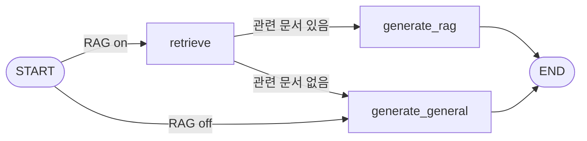
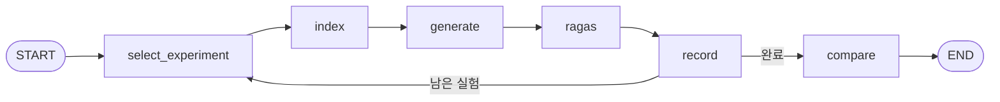

# LangGraph RAG Tuning

LangGraph로 구성한 RAG 챗봇과, RAGAS로 **Chunk Size · Overlap · Top-K · Similarity Threshold**를 비교하는 평가 파이프라인입니다.

- **데이터**: SSAFY 교육생 가이드(규정 문서), 전국 관광지 정보(공공데이터 735곳)
- **스택**: FastAPI · LangGraph · LangChain · ChromaDB · BM25 · RAGAS · OpenAI API

## 파이프라인

### RAG 답변 그래프 (`servers/main.py`)



- **retrieve**: Vector(코사인 유사도) 또는 Hybrid(Vector + BM25, RRF 결합) 검색 후 Threshold 필터
- 관련 문서가 없으면 일반 응답으로 전환하고, 화면에 "일반 생성형 AI 응답 (관련 문서 없음)"을 표시
- Top-K · Threshold · 검색 방식은 실행할 때 `config={"configurable": {...}}`로 주입 (기본값은 `.env`)

### 평가·튜닝 그래프 (`servers/eval_ragas.py`)



실험마다 청킹 설정별 인덱스를 만들고(`index`), 답변 그래프를 그대로 실행한 뒤(`generate`), RAGAS 4개 지표로 채점해 저장합니다.

## 진행 흐름

```
① 문제의식   RAG 성능은 LLM만으로 결정되지 않는다. 문서를 어떻게 자르고 몇 개를 가져오느냐가 답변을 바꾼다
② 가설       Chunk Size · Overlap · Top-K · Threshold가 검색 품질을 좌우할 것이다
③ 실험 1     SSAFY 규정 문서, 테스트 케이스 10개로 설정 4가지 비교
④ 발견       큰 청크가 가장 좋았고, 검색 결과를 줄이는 튜닝은 오히려 손해였다
             설계 문제도 발견: 변수 2개 동시 변경, L2 점수의 Threshold, 청크를 합쳐 평가
⑤ 개선       평가를 LangGraph 그래프로 재구성하고, 코사인 유사도와 청크 리스트 평가로 수정
⑥ 실험 2     관광지 데이터에서 변수 하나씩만 바꾸도록 재설계 (실행 예정)
```

## 실험 1: SSAFY 교육 규정

SSAFY 가이드를 설정별로 청킹·임베딩해 저장하고, 테스트 케이스 10개(질문 + 정답)로 검색과 답변을 시험한 뒤 RAGAS로 채점한 평균입니다.

| 실험 | Chunk / Overlap | Top-K | Threshold | Faithfulness | Answer Relevancy | Context Recall | Context Precision | Overall |
| --- | --- | --- | --- | --- | --- | --- | --- | --- |
| baseline | 500 / 50 | 5 | 0.00 | 0.9900 | 0.5411 | 0.9000 | 0.6672 | 0.7746 |
| small_chunk | 300 / 50 | 5 | 0.00 | 0.9550 | 0.5376 | 0.8333 | 0.8122 | 0.7845 |
| **large_chunk** | **700 / 100** | 5 | 0.00 | 0.9663 | 0.5363 | **1.0000** | **0.8567** | **0.8398** |
| retrieval_tuned | 500 / 50 | 3 | 0.15 | 0.9800 | 0.5095 | 0.8000 | 0.6833 | 0.7432 |

**결론**

1. **검색 설정은 검색 품질(Recall · Precision)을 바꾸고, 생성 품질(Faithfulness)은 거의 그대로였다.** Faithfulness는 모든 설정에서 0.95 이상이었다.
2. **이 문서에는 큰 청크(700 / 100)가 맞았다.** Overall이 +8.4%로 가장 높았다. 규정 본문과 예외사항이 붙어 있는 문서라 큰 청크 하나가 규정 하나를 온전히 담았다.
3. **작은 청크는 정확도와 누락이 맞바뀌었다.** Precision은 올랐지만(0.667 → 0.812) 규정이 쪼개져 Recall이 떨어졌다(0.900 → 0.833).
4. **검색 결과를 줄이는 튜닝(Top-K 3 + Threshold 0.15)은 손해였다.** Precision은 거의 그대로였고, 필요한 청크까지 빠져 Recall이 가장 낮았다(0.800).
5. **Answer Relevancy는 모든 설정에서 약 0.51~0.54로 비슷했다.** 원인은 검색이 아니라 생성 단계(말투, 답변 형식)에 있다.

**한계**
- 테스트 케이스가 10개라 작은 차이는 우연일 수 있다. 경향을 확인한 수준이다.
- large_chunk와 retrieval_tuned는 변수 두 개를 동시에 바꿨다.
- 현재 코드로 정리하기 전 버전(L2 점수, 청크를 합쳐 평가)에서 측정했다.

## 실험 2: 전국 관광지 (설계)

실험 1의 한계를 반영해 **각 실험이 비교 기준과 변수 하나만 다르도록** 설계했습니다. 테스트 케이스는 14개이며, 그중 "문서에 없음" 2개는 근거 없는 답변을 지어내지 않았는지로 따로 평가합니다.

| 변수 | 실험 | 비교 기준 |
| --- | --- | --- |
| 분할 방식 | `recursive_500_50` (헤더 분할 → 500자 분할) | `baseline` |
| Chunk Size | `recursive_300_50`, `recursive_800_50` | `recursive_500_50` |
| Overlap | `recursive_500_0`, `recursive_500_100` | `recursive_500_50` |
| Top-K | `topk_3`, `topk_8` | `baseline` |
| Threshold | `threshold_0.2`, `threshold_0.3`, `threshold_0.4` | `baseline` |
| 검색 방식 | `hybrid` | `baseline` |

설계 배경과 문제 해결 과정은 [docs/RAG_정리_보완.md](docs/RAG_정리_보완.md)에 정리했습니다.

## 실행

```bash
cd servers
python -m venv .venv && source .venv/bin/activate
pip install -r requirements.txt
```

`servers/.env`

```env
API_KEY=발급받은_API_키
base_url=사용할_API_Base_URL
GPT_MODEL=gpt-5-mini
EMBEDDING_MODEL=text-embedding-3-small
```

선택 항목은 `CHUNK_SIZE`, `OVERLAP`, `MD_SPLIT_MODE`, `RAG_TOP_K`, `RAG_SCORE_THRESHOLD`, `RETRIEVER_MODE`입니다.

**서버 · 클라이언트**

```bash
python main.py                                  # http://localhost:8000 (API 문서: /docs)
cd ../clients && python -m http.server 5500     # http://localhost:5500
```

**문서 업로드** (청킹 설정은 선택)

```bash
curl -X POST http://localhost:8000/upload -F "file=@./data/SSAFY_GUIDE.md" \
  -F "split_mode=recursive" -F "chunk_size=700" -F "overlap=100"
```

**평가**

```bash
python eval_ragas.py --dataset ssafy --all    # 실험 1
python eval_ragas.py --dataset trip --all     # 실험 2
python eval_ragas.py --dataset trip --list    # 실험 목록과 비교 기준
python eval_ragas.py --graph                  # 그래프 구조(Mermaid) 출력
```

결과는 `servers/eval_results/`에 비교표(`experiments_<데이터셋>.md`)와 질문별 상세 CSV로 저장됩니다.
